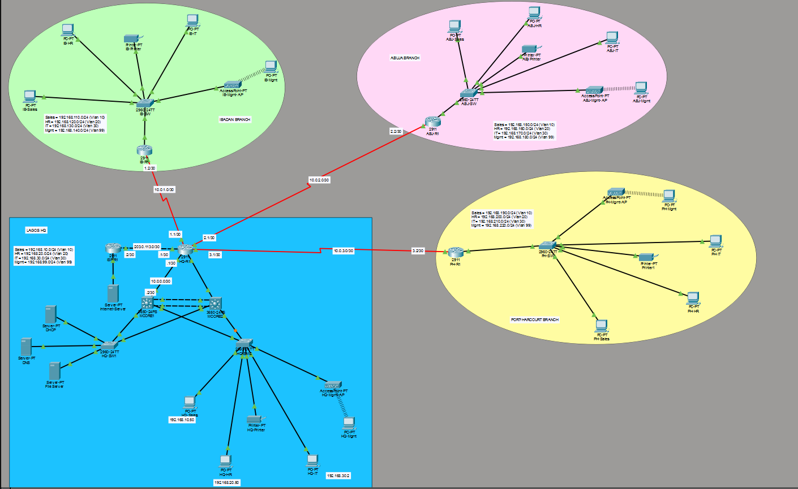

# CrownTouch Logistics – Multi-Branch Enterprise Network

A simulated multi-branch enterprise network designed and built in **Cisco Packet Tracer**.

## Project Overview

CrownTouch Logistics is a simulated enterprise network that connects the **Lagos headquarters** to three branch offices in **Abuja, Ibadan and Port Harcourt** using a hub-and-spoke WAN topology.

The network uses departmental VLANs, inter-VLAN routing, dynamic routing, centralised network services and access-control mechanisms. Together these provide structured communication between locations while improving network security and manageability.

## Network Topology



The topology consists of:

- Lagos headquarters serving as the central network hub.
- Branch routers and access switches for Abuja, Ibadan and Port Harcourt.
- Two multilayer switches forming the headquarters core.
- Dedicated servers for DHCP, DNS and file services.
- A simulated ISP and external server for NAT testing.

## Addressing Plan

| Location | Department | VLAN ID | Subnet |
| --- | --- | --- | --- |
| Lagos HQ | Sales | 10 | 192.168.10.0/24 |
| Lagos HQ | HR | 20 | 192.168.20.0/24 |
| Lagos HQ | IT / Servers | 30 | 192.168.30.0/24 |
| Lagos HQ | Management | 99 | 192.168.99.0/24 |
| Ibadan | Sales | 10 | 192.168.110.0/24 |
| Ibadan | HR | 20 | 192.168.120.0/24 |
| Ibadan | IT | 30 | 192.168.130.0/24 |
| Ibadan | Management | 99 | 192.168.140.0/24 |
| Abuja | Sales | 10 | 192.168.150.0/24 |
| Abuja | HR | 20 | 192.168.160.0/24 |
| Abuja | IT | 30 | 192.168.170.0/24 |
| Abuja | Management | 99 | 192.168.180.0/24 |
| Port Harcourt | Sales | 10 | 192.168.190.0/24 |
| Port Harcourt | HR | 20 | 192.168.200.0/24 |
| Port Harcourt | IT | 30 | 192.168.210.0/24 |
| Port Harcourt | Management | 99 | 192.168.220.0/24 |

## Configured Network Services and Technologies

| Technology | Implementation |
| --- | --- |
| OSPF | Dynamic routing between headquarters and branch networks. |
| DHCP | Automatic IP address allocation to client devices. |
| DNS | Internal hostname resolution using `dns.crowntouch.local`. |
| NAT Overload | Allows internal and branch networks to access a simulated external network through the HQ router. |
| ACLs | Restricts traffic from the HR network to the Sales network. |
| SSH | Secure remote administration of network devices. |
| Port Security | Limits the number of MAC addresses learned on protected switch ports. |
| VLANs | Separates Sales, HR, IT and Management traffic. |
| Inter-VLAN Routing | Enables communication between authorised departmental networks. |
| LACP EtherChannel | Bundles physical links between the headquarters core switches. |
| Rapid PVST+ | Helps prevent Layer 2 switching loops. |

## Testing and Verification

The following tests were performed to verify the network implementation:

| Test | Verification Method | Result |
| --- | --- | --- |
| IP addressing | `ipconfig` on client PCs | DHCP addressing verified on tested clients. |
| Local connectivity | `ping` between PCs and gateways | Successful on tested paths. |
| Inter-branch connectivity | Ping between branch and HQ endpoints | Successful on tested paths. |
| OSPF routing | `show ip ospf neighbor` and `show ip route ospf` | Neighbours reached FULL and branch routes were learned. |
| WAN restoration | Shut down and restore the Port Harcourt WAN interface | OSPF adjacency and route recovered after restoration. |
| DNS resolution | `ping dns.crowntouch.local` | Hostname resolved to 192.168.30.11. |
| NAT | `show ip nat translations` | Address translations observed during external-server testing. |
| ACL | HR-to-Sales ping and `show access-lists 101` | HR-to-Sales traffic was blocked; HR gateway remained reachable. |
| SSH | SSH login to MCORE1 | Successful remote login verified. |
| Port security | `show port-security` | Port-security status verified on tested HQ access ports. |
| EtherChannel | `show etherchannel summary` | LACP bundle reported operational. |
| Spanning Tree | `show spanning-tree summary` | Rapid PVST+ mode verified. |

## How to Verify the Project

Download the `.pkt` file and open it in Cisco Packet Tracer.

To check the work independently, inspect the topology and run these commands on the relevant devices:

```
show ip interface brief
show vlan brief
show interfaces trunk
show etherchannel summary
show spanning-tree summary
show ip ospf neighbor
show ip route
show access-lists
show ip nat translations
show port-security
show running-config
```

Client-side tests can also be run on the PCs:

```
ipconfig
ping 192.168.30.11
ping 192.168.30.12
ping 198.51.100.10
```

To verify the departmental access policy, test communication from an HR client to a Sales client and confirm that the ACL deny counter increases.

## Project Files

| File | Description |
| --- | --- |
| `CrownTouch_Logistics.pkt` | Cisco Packet Tracer network simulation. |
| `README.md` | Project overview, addressing plan, technologies and verification guide. |
| `images/topology.png` | Network topology screenshot. |

## Notes

This is a simulated enterprise network. The ISP and external server are simulated within Packet Tracer and do not represent a live internet connection.

The verification results above describe the tests performed on the documented configuration. They should not be read as proof that every device and every possible traffic path has been tested.
